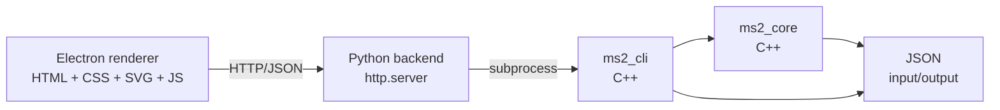

# 03 — Arquitetura

O projeto separa matemática, orquestração e interface. O contrato entre as camadas é JSON.

→ [Voltar ao README](Home/Projetos/MS2_projeto2/README.md)

## Diagrama de camadas



## Responsabilidades

| Camada | Responsabilidade | Não faz |
|---|---|---|
| `ms2_core` | Elemento, montagem, CCs, solver, pós-processamento | Não lê arquivos nem conhece HTTP |
| `ms2_cli` | Ler JSON de arquivo ou texto, chamar o solver, escrever JSON | Não contém matemática |
| Backend Python | Servir a API local, executar a CLI, tratar erros | Não contém matemática |
| Electron renderer | Editar modelo, visualizar resultados e diagramas | Não calcula esforços |

## Fluxo de uma análise

1. O renderer envia `POST /api/solve?samples=N` com o modelo JSON.
2. O backend grava o corpo em um arquivo temporário.
3. O backend executa `ms2_cli --input ... --output ... --samples N`.
4. A CLI lê o JSON com `InputParser`, monta o modelo e chama `BeamSolver::solve`.
5. O `PostProcessor` gera deslocamentos, reações, esforços e diagramas.
6. `OutputWriter` grava o JSON de saída.
7. O backend lê o JSON e devolve ao renderer.
8. O renderer atualiza painéis e canvas SVG.

## Estrutura de diretórios

```text
MS2_projeto2/
├── CMakeLists.txt
├── README.md
├── Assets/
├── docs/
├── examples/
├── scripts/
├── src/
│   ├── cpp/
│   │   ├── include/ms2/
│   │   ├── src/
│   │   └── main.cpp
│   ├── python/
│   │   └── backend/server.py
│   └── electron/
│       ├── main.js
│       ├── preload.js
│       ├── package.json
│       └── renderer/
├── tests/
│   ├── cpp/
│   └── python/
└── third_party/
```

## Decisões de projeto

- **C++ para o núcleo:** tipagem forte, classes pequenas e testes rápidos.
- **Python stdlib:** evita dependências e problemas de ambiente; o backend só orquestra.
- **Electron + SVG:** desktop multiplataforma e visualização vetorial sem bibliotecas gráficas.
- **JSON único:** o mesmo contrato serve CLI, API, testes e GUI.
- **Headers vendorizados:** `nlohmann/json` e `Catch2` ficam em `third_party/`.

## Tratamento de erros

| Origem | Comportamento |
|---|---|
| JSON inválido | `InputParser` lança `std::runtime_error`; CLI retorna código diferente de zero |
| Modelo inconsistente | Validação de IDs, conectividade, `E`, `I`, apoios e cargas |
| CLI ausente | Backend retorna HTTP 500 com mensagem |
| Modelo inválido | Backend retorna HTTP 400 com o stderr da CLI |
| Timeout | Backend retorna HTTP 504 |
| Backend indisponível | Renderer tenta reconectar por até 10 s e mostra erro |

## Testes

- **C++:** 18 casos, 80 asserções, executados por `ms2_tests`.
- **Python:** 6 casos de API, executados por `ms2_backend`.
- **Validação numérica:** `scripts/validate_examples.py` compara os quatro exemplos com `expected.json`.

## Limitações arquiteturais

- O backend usa uma porta fixa (`8765`); uma evolução natural é escolher porta livre e informar ao renderer.
- A GUI atual edita o modelo por JSON; edição visual por arraste está no roadmap.
- Não há persistência de projetos; importação/exportação usam arquivos JSON.
